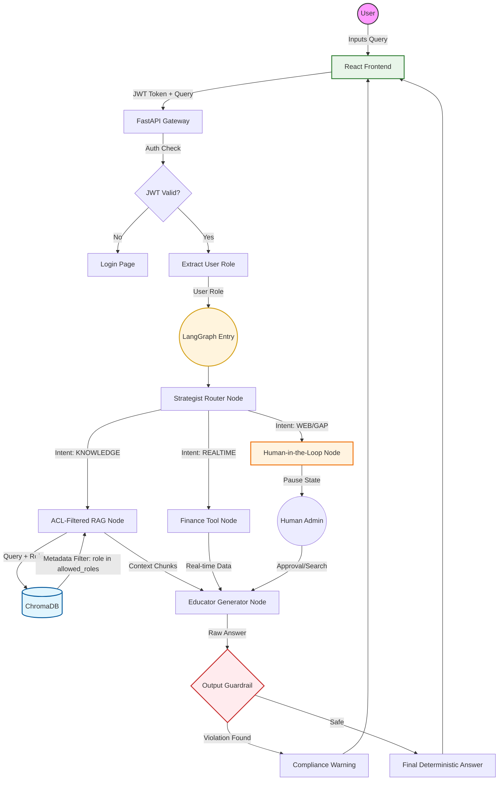

# 🗺️ EquiVault AI: Detailed Architecture Flow

This document describes the end-to-end logic of the EquiVault AI system. You can copy the code block below and paste it into the [Mermaid Live Editor](https://mermaid.live/) to generate a high-resolution, colorful visual diagram.

## 📊 Visual Flow Chart (Mermaid Code)

## 📝 Detailed Step-by-Step Explanation

### 1. The Request Phase
- **Auth**: The user sends a request with a JWT. The gateway validates the identity and extracts the **Role** (Basic, Premium, or Admin).
- **Input Guardrail**: Before the agent starts, the input is scanned for "off-topic" content or prompt injection attempts.

### 2. The Reasoning Phase (LangGraph)
- **The Router**: The LLM analyzes the query to decide the path. 
    - If it's a concept $\rightarrow$ **RAG**.
    - If it's a price $\rightarrow$ **Tool**.
    - If it's a mystery $\rightarrow$ **Human**.
- **ACL Filtering**: The RAG node doesn't just search for keywords; it tells ChromaDB: *"Only give me chunks where the `access_level` matches the user's role."*

### 3. The Verification Phase
- **HITL**: If the agent hits the `human_approval` node, the state is saved (checkpointed), and the system stops. A human must verify the request before it proceeds to a web search.
- **Generation**: The AI synthesizes the answer using a "hardened" prompt that prevents the user from overriding system instructions.

### 4. The Compliance Phase
- **Output Guardrail**: The final response is scanned for forbidden phrases (e.g., "guaranteed profit"). If found, the response is blocked to ensure the system remains a "Financial Education" tool and not an "Investment Advisor."
