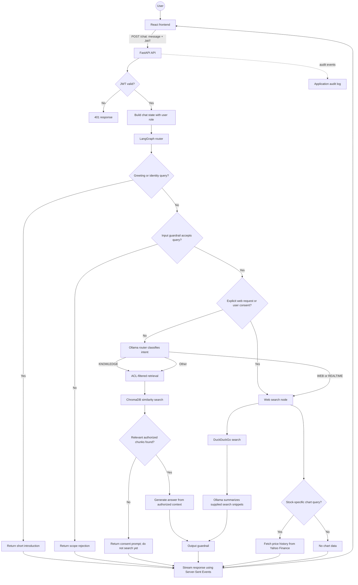
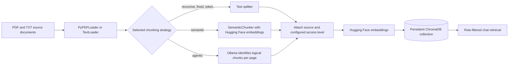

# EquiVault AI Architecture

This document describes the implemented application and ingestion flows.

## Chat request flow

### Chat behavior

- `POST /token` authenticates the in-memory development accounts and issues a JWT. Protected endpoints, including `/chat`, validate that token.
- The router directly handles greetings and identity questions, then checks the input guardrail. A query outside the supported stock-market and investing scope is rejected.
- An explicit web request or a user-confirmed web-search prompt routes to web search. Otherwise, Ollama classifies the query. `KNOWLEDGE` uses retrieval; `WEB` and `REALTIME` both route to the web-search node.
- Retrieval applies the role hierarchy (`Basic`; `Premium` plus `Basic`; `Admin` plus lower roles) as a ChromaDB metadata filter. If no authorized result reaches the relevance threshold, the app asks whether to search the web and waits for user consent.
- Answer generation uses only retrieved authorized context. The web summarizer receives JSON-encoded search snippets as untrusted data and has no tools. Both generated answers and web summaries are checked for prohibited financial guarantees.
- For stock-specific web queries with a resolvable equity symbol, the web-search node fetches one-year daily price data from Yahoo Finance. The frontend renders a price/volume chart when chart data is returned; it does not generate arbitrary diagrams or earnings-calendar charts.
- The API streams status, text, and final metadata (sources, chart data, and search-consent state) to the React frontend using SSE. LangGraph uses an in-memory `MemorySaver` checkpointer; it is not durable storage.

## Document ingestion flow

The access level is configured for each source filename in `backend/ingestion.py`. New files must be added to that mapping before ingestion; unknown files fail closed.
